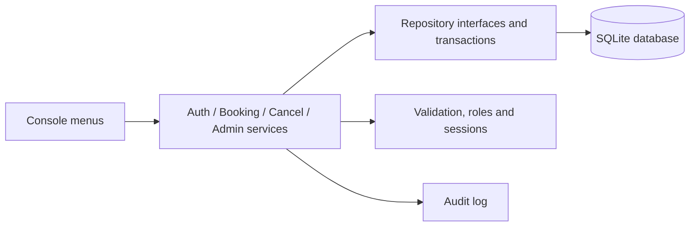

# Beginner guide to the railway project and viva

Read this alongside the executable and test reports. The short answers below describe what the project implements; practise explaining them in your own words and run the demonstration yourself. All final counts and coverage percentages should be taken from the generated reports, not from an earlier sprint snapshot.

## 1. What is this project?

Suggested answer: "Our project is a railway reservation simulation. A passenger can register, log in, search trains, check availability and fare, book tickets, see a PNR and booking history, and cancel an eligible ticket. Staff can book on behalf of a passenger and correct reservation details. Administrators maintain trains/routes/schedules/capacity, and operations staff can view reports. We used a console UI with a SQLite backend."

A console UI means you enter choices in a terminal rather than clicking a website. SQLite means data is stored in a local database file. Closing the application does not delete bookings. This coursework project does not talk to IRCTC/live railway servers and does not take real payments.

## 2. Which language and tools did you use?

"The application is C++17. SQLite stores the data and uses SQL. GoogleTest runs C++ unit/integration/security/performance checks. Python drives the real executable and generates reports. CMake builds the project; Bash, Docker, GitHub Actions and a Jenkinsfile provide reproducible CI. OpenSSL provides password hashing."

GCC 13/Ubuntu 24.04 under WSL is the verified environment. WSL runs Linux tools on this Windows computer. Do not claim that native Windows/MSVC or a hosted Jenkins server was tested: the report distinguishes those from the verified runs.

## 3. What did your part involve?

The work assigned to `be-hope` covers registration/login/profile, shared validation, sessions/access control/audit, passenger history, traveller/journey validation, staff reservation operations, security tests, and final integration/documentation. The team supplied the booking/database, train/admin and cancellation/refund modules through separate PRs. Explain your module boundaries rather than claiming that every team module was your individual work.

## 4. What difficulties did the project face?

"The main difficulty was integrating independently developed modules. Some code used different names for the same data-access operation, and the integrated entry point referenced a missing train-administration header. A standalone module compiling was not enough to prove the whole application compiled. We standardized on shared domain records, Result<T>, DataAccess and repository interfaces, then added cross-module tests."

Other concrete difficulties:

- Seed tooling and authentication both changed the seed functions. We resolved conflicts so repeated seeding stays deterministic, existing accounts are not overwritten, and usable demo credentials are opt-in.
- A new session guard checks private authenticated state. A hard-coded role/session object cannot substitute for real login in the final application.
- Booking, cancellation and waitlist promotion must agree on ownership, status, capacity and seat uniqueness. The cancellation workflow releases a seat and promotes waiting tickets in one transaction.
- An availability check originally looked at configuration/schedules without checking whether the train was active. The final regression catches that.
- The cancellation module initially permitted only passengers, while the permission matrix also permits staff/admin. The integrated test exposed that mismatch.
- Shared temporary test database filenames caused interference during concurrent test runs. Performance/reliability fixtures now use unique paths.
- Windows/OneDrive/WSL made file operations and test discovery slower. Bash scripts use LF endings and test discovery has a 60-second setup timeout.

These are documented issues with observable code/log evidence. Do not invent a crash or a sprint date that is not recorded.

## 5. What challenges occurred in Sprint 1?

"Sprint 1 established the common records and authentication/security foundation. We needed to reject duplicate mobile/email accounts, avoid plaintext passwords, enforce role restrictions and handle session expiry/lockout consistently. Shared interfaces were important because later modules depended on them."

Example: store a salted hash, not the password. On login, derive a candidate hash from the supplied password and stored salt, compare it, and create a role-bound session only on success. Five wrong attempts lock the account for five minutes. A fixed clock makes exact time boundaries testable without a live wait.

## 6. What challenges occurred in Sprint 2?

"Sprint 2 combined fare quotes, validation, booking, seats, PNRs and history. We had to avoid floating-point money errors, duplicate tickets on retries, two passengers receiving the same seat, and users reading another account's bookings."

Money is stored in integer paise. A request ID makes retrying the same booking return the original ticket. SQLite uniqueness constraints and a transaction protect PNR/request/seat integrity. History always uses the authenticated passenger account, not an arbitrary account typed by the caller.

## 7. Show two tests that failed, and explain the fix

The logs are real regression reproductions. We ran the current regression cases in an isolated source copy with the pre-fix booking/cancellation service snapshots archived in `tests/regression_fixtures/` (recorded during integration at local checkpoint `17a5a29`). They are newly added regression tests demonstrating older behavior; they are not a claim that those exact tests existed during Sprint 1/2.

### Failure A: inactive train availability / invalid same-station fare

Setup: administrator deactivates train 20001. Action: ask for availability for a scheduled future date. Expected: E2001 (train unavailable). Before fix: successful availability was returned because only class configuration and schedule were checked. Another assertion checks that SBC-to-SBC cannot produce a fare quote; before fix it succeeded with zero distance. Fix: check train activity before availability and validate journey stations before quoting.

### Failure B: authorized staff cancellation

Setup: passenger owns a confirmed Rs 350 booking three days in the future. Action: authenticated staff cancels its PNR. Expected: cancellation succeeds, state becomes CANCELLED, and refund is Rs 315 (90%). Before fix: the cancellation entry point allowed only Passenger, so Staff was rejected. Fix: allow Passenger/Staff/Admin and retain the ownership restriction for passenger accounts; Ops remains forbidden.

Show:

```sh
cat docs/reports/regression-before.log
./build-final/tests/rrs_integration_tests --gtest_filter='*FinalIntegration.InactiveTrainHasNoAvailabilityAndSameStationHasNoFare*:*FinalIntegration.StaffCancelsWithRefundAndOpsIsDenied*'
cat docs/reports/regression-after.log
```

Each scenario runs against memory and SQLite, so two parameterized test names produce four executions. The earlier missing-header compiler failure is separately recorded in build-before.log; it is a build defect, not a failed unit assertion.

## 8. What kinds of tests did you have?

- Unit: money/date arithmetic, fares, seat allocation, PNR generation, booking field rules, refund boundaries, ticket status transitions and queue planning.
- Integration: repository round trips and transactions; availability -> quote -> booking; ownership/history; cancellation -> refund -> seat release -> promotion; administrator configuration and report totals. Many run once with memory fakes and once with real SQLite.
- Security: password hashing, duplicate registration, malformed inputs, role/ownership matrix, changed/expired/revoked sessions, lockout, audit and ID masking/retention.
- System: a Python driver starts the compiled app, supplies the same menu inputs a user would type, restarts it, and checks the resulting SQLite rows/output.
- Non-functional: search/booking latency on generated data, a 1,000-operation reliability sequence, retry/restart integrity, compiler warnings, static analysis, sanitizers and measured coverage.

A negative test is not automatically a failed test. If age 0 is expected to be rejected and the app returns a validation error, the test passes. A failed test means the actual result differs from the expected result, as in the archived inactive-train and staff-cancellation examples.

## 9. How many test cases were there?

Open unit-test-report.md and system-validation-report.md for the final exact count. CTest counts individual C++ test executions, including separate memory/SQLite variants. The Python system suite is counted separately. A pass rate is not a coverage percentage, and counting a parameterized execution twice is different from claiming two distinct business scenarios.

The machine-readable complete catalogue is reports/test-case-catalogue.csv. The updated test-case document is test-cases.md. Historical branch reports have smaller totals because tests were added during integration.

<!-- FINAL_FACTS_START -->

Final measured facts: **267 C++ executions** (63 unit, 181 integration, 15 security, 8 performance/reliability), plus **12 system scenarios**. Business line coverage: **1268/1298 (97.69%)**; business decision branch coverage: **1771/2245 (78.89%)**. See the reports for the whole-production raw metrics and filtering definitions.
<!-- FINAL_FACTS_END -->

## 10. Show and explain one test

```sh
./build-final/tests/rrs_integration_tests --gtest_filter='*FinalIntegration.StaffCancelsWithRefundAndOpsIsDenied*'
```

Open `tests/integration/test_final_integration.cpp`. The test has three parts:

1. Arrange: seed a fixed date, create a passenger session, book a ticket, and construct cancellation/seat-release services.
2. Act: try Ops cancellation (must fail), then Staff cancellation (must succeed).
3. Assert: verify the ticket is CANCELLED and refund is 31,500 paise.

A fixture prepares the environment. An assertion compares actual behavior with expected behavior. `ASSERT_TRUE` stops that test when a required setup/action fails; `EXPECT_EQ` records a mismatch and continues. GoogleTest reports the test as failed if any required assertion fails.

For a simpler unit demonstration:

```sh
./build-final/tests/rrs_unit_tests --gtest_filter='FarePolicy.UT_BKG_01_TotalFareCases'
```

The 350 km / 3A / two travellers example is 350 x 2.5 x 2 = Rs 1,750. It is stored as 175,000 paise. See `src/booking/fare_policy.cpp` and `tests/unit/test_fare_policy.cpp`.

## 11. What is the backend, and how do you show it?

"The backend is SQLite plus a C++ data-access layer. Tables hold accounts, stations, trains, route stops, schedules, class capacity, reservations and travellers. The UI calls services; services use repository interfaces; the SQLite repositories execute prepared statements."

```sh
python3 tools/inspect_database.py demo.db
```

This opens read-only and prints counts/reservations without password hashes. See schema.sql-equivalent text in `src/dal/schema.cpp` for exact CREATE TABLE and index definitions.



A reservation records owner (`account_id`), creator (`booked_by`), PNR, request ID, train/date/class/leg, fare, status, queue order and refund. Traveller rows record name/age/gender/ID and allocated seat. A staff booking can have different owner and creator.

## 12. What happens when a user books?

Login authenticates the account. The user selects a train/date/leg/class and enters 1-6 travellers. The service validates fields and gets an accepted fare quote. Inside a transaction it checks the request ID again, reads capacity/occupancy, chooses CONFIRMED/RAC/WAITLISTED, allocates free seats when confirmed, generates a unique PNR, inserts the reservation/travellers and commits. A failure rolls back. The UI then displays the ticket.

CONFIRMED means a seat is allocated. RAC means a configured reservation-against-cancellation quota is used; this model does not display a confirmed seat for it. WAITLISTED means a queue position is recorded. CANCELLED ends an active reservation. Queue promotion preserves booking order and keeps groups together rather than splitting a party to skip ahead.

## 13. What is a transaction? Why use it?

"A transaction groups related database changes so all succeed together or none persist. A ticket must not be saved with only half its travellers or seats. Cancellation, seat release and queue promotion must also agree."

`TransactionGuard` begins the unit of work and rolls back when a function exits without a successful commit. SQLite foreign keys, unique PNR/request IDs and a partial unique seat index provide an additional integrity backstop. Services return typed errors instead of making the UI guess what failed.

## 14. How is authentication secured?

"Passwords use PBKDF2-HMAC-SHA256 with 600,000 iterations and a separate random 16-byte salt. Verification re-derives and compares the hash; we never decrypt a password. Sessions bind token/account/role using private process-local state. A changed public role field cannot grant administrator access."

Unknown user/wrong password use a generic invalid-credentials error and perform PBKDF2 work. Failed login count and lockout time persist in SQLite. Sessions expire after 15 idle minutes; successful allowed operations renew activity. Logout revokes copied sessions. IDs are masked on display and old reservation IDs are retained only for the specified window. Hash-chained audit entries record relevant events without passwords or IDs.

Do not describe this as a complete production security guarantee. One process per database/audit pair is supported; Windows ACLs and an external audit anchor are operational responsibilities.

## 15. What is code coverage versus branch coverage?

Line coverage = executed instrumented source lines / instrumented executable lines. Branch coverage = taken compiler-recorded branches / recorded branches. For `if (valid)`, tests should exercise both valid and invalid paths. A line can execute while only one decision path is covered.

Open code-coverage-report.md and branch-coverage-report.md. The HTML report shows per-file results. The denominator includes compiled production C++ under src/ and tools/, not GoogleTest/OpenSSL internals, tests or historical root prototypes. GCC may record exception/error-handling branches too. Remaining uncovered paths are reported openly; passing every test does not establish 100% coverage or prove absence of defects.

## 16. Can another team understand and extend it?

"Yes. They can follow README setup, run the demo/tests, then trace a menu action from main/UI to its service and repository. Shared domain records, small service classes, typed results and tests make the boundaries clear. The viva/demo guide and test traceability help them understand why behavior exists."

It still takes familiarity with C++17, SQL and the requirements; understanding is not instant. Earlier standalone prototypes are documented as historical and excluded from the application target, avoiding confusion about the active model.

A team can add a new screen or reporting feature over existing services. They can implement a new database adapter behind the repository interfaces. Adding a new travel class requires coordinated changes to domain parsing, schema/configuration, fare/UI and tests. A web frontend could reuse business services through an API layer; that layer would need new work. Reuse does not mean every future requirement is free.

## 17. Which software-engineering concepts were applied?

| Concept | Concrete project example |
| --- | --- |
| Requirements engineering | SRS functional/non-functional/security IDs; acceptance rules mapped to tests |
| Agile planning | Assigned issues, sprint milestones and project board statuses |
| Version/configuration management | Git commits, feature branches, PRs and final integration |
| Modular/layered design | UI -> services -> repository interfaces -> SQLite; shared domain/error types |
| Abstraction/dependency injection | DataAccess ports, in-memory fake repositories and injectable clock |
| Data integrity | Transactions, foreign keys and unique request/PNR/seat constraints |
| Defensive programming | Input validation, role/ownership guards, bounded fields and typed failures |
| Test design | Equivalence classes, boundary values, positive/negative, integration and system scenarios |
| Regression testing | Same inactive-train/staff-cancellation cases fail before and pass after fixes |
| Reliability/idempotency | Retry with same request ID returns original reservation |
| Quality assurance/CI | Strict warnings, GoogleTest, static analysis, sanitizers, Docker pipeline and coverage |
| Maintainability | Shared InputValidator/fare logic, documented build/run steps and tests for future changes |

Do not claim full TDD or a live CI/Jenkins deployment just because tests/pipeline files exist. The evidence identifies what was actually run.

## 18. What was the outcome of testing?

Use the final reports: say how many tests executed/passed, quote measured line/branch coverage, identify the tested source revision/date, and show the two fixed regressions. The accepted result should be "all executed tests passed on the recorded platform, with the listed coverage and limitations," rather than "the program can never fail."

The legacy November 2-6 delivery window is not the date of the final run. Report the real verification date recorded in execution-environment.txt.

## 19. How do we show the project board and commit history?

On GitHub open Projects -> Sprint_board. Explain Todo -> In Progress -> In Review -> Done. The issue describes a task; a branch holds work; commits are checkpoints; a PR proposes merging work; CI supplies checks. The board is planning evidence, not a substitute for runnable tests.

```sh
git log --oneline --graph -12
git show --stat HEAD
```

Explain what the integration commit changed and why. Requirements/issues remain the references for what counts as done. Automatic issue closure requires correct PR linkage/merge behavior, and project status automation is separate.

## 20. A short live explanation to practise

"This is a C++17 railway reservation console application with a SQLite backend. Our project was split into authentication/security, trains/routes/fares, booking/data access and cancellation/status/reporting work. We developed in sprints using issues and PRs. During final integration we fixed interface mismatches and added regression tests for cross-module rules. I will demonstrate login, a quoted two-passenger booking, private history, cancellation/refund and waitlist promotion. Then I will show one test, the real failure-before/fix-after evidence, the four test reports, the project board, commit history and backend tables. The final reports give the exact pass counts and measured coverage."
